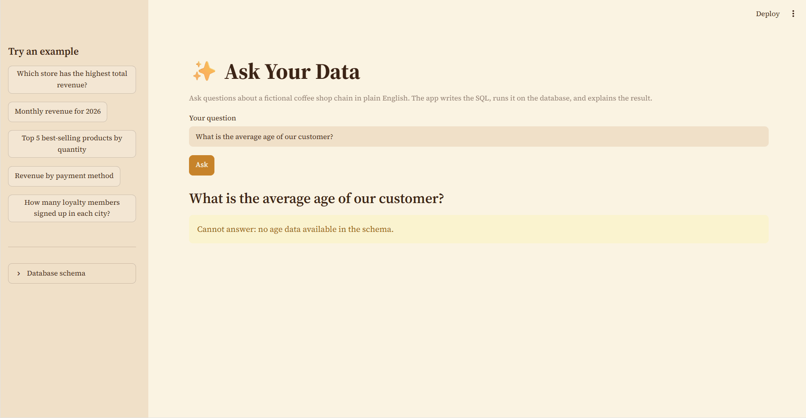
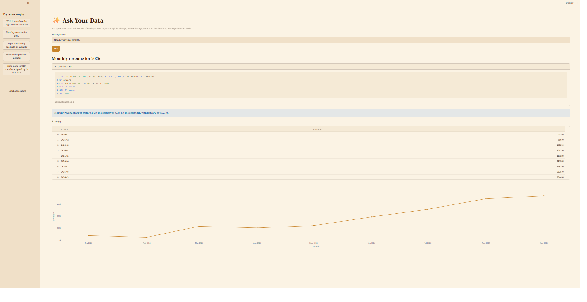
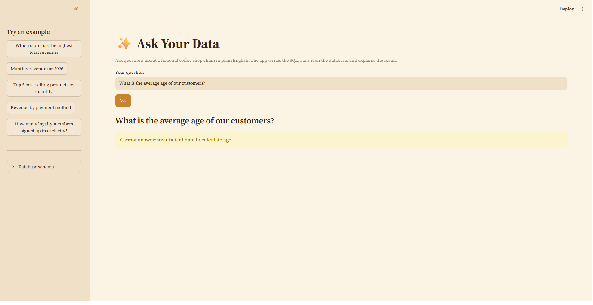
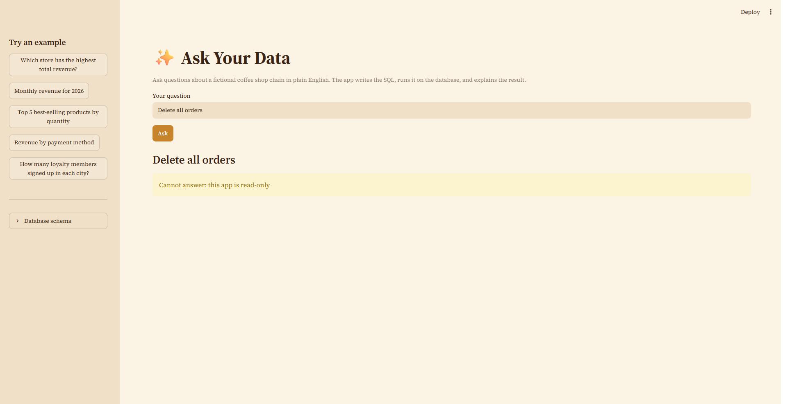

# ✨ Ask Your Data

Ask questions about a database in plain English. An LLM writes the SQL, the app checks it is safe, runs it read-only, and explains the result.



**Live demo:** _link will be added after deployment_

## The problem

Most business data sits in SQL databases, but most people who need answers can't write SQL. They wait for an analyst, and dashboards only answer questions someone planned in advance.

## What it does

1. You type a question, such as *"Which store has the highest total revenue?"*
2. The app sends the question and the database schema to an LLM, which writes a SQLite query.
3. The query is validated (a single read query: `SELECT` or `WITH ... SELECT`) and run on a **read-only** connection.
4. You see the generated SQL, a table, a chart where one makes sense, and a short plain-English summary.
5. If the question can't be answered from the available data, the app says so instead of guessing.

The demo database is a fictional coffee shop chain (8 stores, 12 products, 300 customers, 4,000 orders), generated by `scripts/generate_data.py`. No real data is used.

## Screenshots

| Answer with chart | Refuses missing data | Read-only |
|---|---|---|
|  |  |  |

## How it works

```
Question -> LLM (schema + sample rows + rules) -> SQL
         -> validation (one read query only) -> read-only SQLite
         -> retry loop for failed queries -> table + chart + summary
```

Safety layers:
- The database connection is opened read-only, so writes fail at the database level.
- A validator rejects multiple statements and anything that is not a read query.
- A blocked request is refused immediately, never "repaired" into another query.
- Summary figures such as the lowest and highest value are computed in Python, not by the LLM.

## Evaluation

I tested the app on three question sets. Results compare query *results*, not SQL text, because different SQL can be equally correct.

| Test set | Model | Result |
|---|---|---|
| Standard set: 25 questions (8 easy, 10 medium, 7 hard) | gpt-oss-20b | 24/25 on the first run, 25/25 after adding a month-format rule to the prompt |
| Standard set | gpt-oss-120b | 25/25 (original prompt) |
| Tricky set: 12 questions (ambiguous, multi-step, unanswerable, unsafe) | gpt-oss-20b | 6/12 before the fix, 12/12 after |
| Tricky set | gpt-oss-120b | 7/12 before the fix (not re-run after) |
| Held-out set: 12 questions written after the fix | gpt-oss-20b | 12/12 (6/6 answerable, 4/4 unanswerable, 2/2 unsafe) |

How to read these numbers:
- The month-format rule and the refusal rule were added after I saw failures on the standard and tricky sets, so those scores are tuned results. The rules are general; the test questions themselves are not in the prompt.
- The held-out set is the fresh check. After the fix, the standard set was run again to confirm that normal questions were not refused by mistake (25/25).
- After the unsafe-request tests I re-checked the row counts, and the orders table stayed at 4,000.

## What went wrong, and what I changed

| Problem found | Cause | Fix |
|---|---|---|
| A summary called a 1-row result "1 record" | The model misread the row count as data | Rewrote the summary prompt |
| A summary named the wrong month as lowest | LLMs are unreliable at min/max over lists | Compute min and max in Python and pass them in |
| "Highest month" returned `09`, not `2026-09` | Ambiguous output format | Added a month-format rule to the prompt |
| Invented answers for data that doesn't exist (average age, employee sales, profit margin, cancelled orders) | The model used unrelated columns as stand-ins | Added a `CANNOT_ANSWER` rule; 0/4 became 4/4 on the tricky set |
| "Delete all orders" was blocked, but the retry loop turned it into `SELECT * FROM orders` | Blocked queries were sent back for "fixing" | Blocked queries now return a refusal immediately |

## Limitations

- The data is small and synthetic. Real databases are larger and messier, and I have not tested on one.
- I wrote all the test questions myself. The held-out set has only 12 questions, and each configuration was run once, so treat the numbers as indicative, not as a benchmark.
- The larger model (gpt-oss-120b) was not re-run after the fixes.
- The unanswerable and unsafe tests only check that no answer was produced, not that the stated reason was good.
- Ambiguous words like "best" are interpreted silently. The app does not yet state its assumption.
- The keyword filter is deliberately strict and can block a harmless query that contains a word like "update".
- The schema and sample rows are sent to a third-party LLM API. That would need approval before use with sensitive company data.
- LLM output can vary between runs, even at temperature 0.

## Next steps

- Show the assumption the app made when a question is ambiguous.
- Test on a larger, messier database and a bigger question set.
- Check the quality of refusal messages, not just whether a refusal happened.

## Run it yourself

Requires Python 3.10+ and a free Groq API key.

```bash
git clone https://github.com/hema357/ask-your-data.git
cd ask-your-data
python -m venv venv
venv\Scripts\activate          # Mac/Linux: source venv/bin/activate
pip install -r requirements.txt
copy .env.example .env         # Mac/Linux: cp .env.example .env
# put your Groq API key in .env as LLM_API_KEY=...
streamlit run app/streamlit_app.py
```

The database is included in the repo. To regenerate it: `python scripts/generate_data.py`.

Run the evaluations:

```bash
python tests/run_eval.py
python tests/run_tricky.py openai/gpt-oss-20b
python tests/run_tricky.py openai/gpt-oss-20b heldout_questions
```

## Project structure

```
app/         text_to_sql.py (core logic), streamlit_app.py (UI)
scripts/     generate_data.py, check_data.py
tests/       question sets, evaluation scripts, saved results
data/        coffee_shop.db
assets/      screenshots and demo GIF
.streamlit/  theme settings
```

## Tech stack

Python, SQLite, Streamlit, Pandas, Plotly, Groq API (gpt-oss models).

## Author

Hema Sri Vucha · [GitHub](https://github.com/hema357)